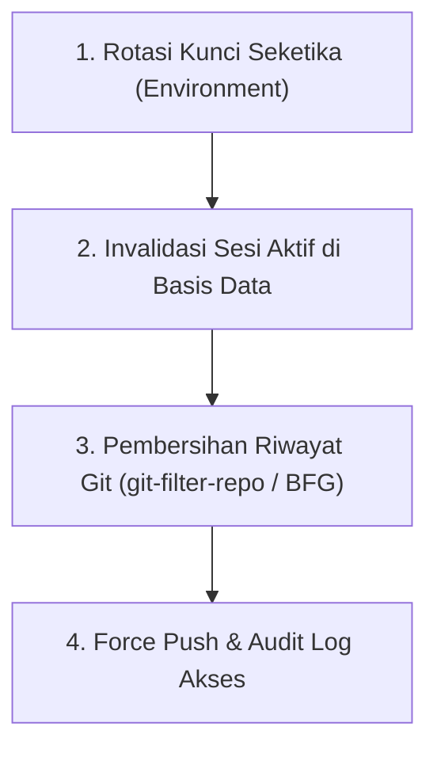

# Latihan Mandiri Keamanan Lanjutan (Jobsheet 12 — Bagian 6)

Dokumen ini memuat laporan analisis mendalam dan kajian teknis untuk tiga topik latihan mandiri keamanan perangkat lunak pada proyek **Exito Playbox** (`rpl-project-ps`), sesuai dengan arahan Jobsheet 12 Bagian 6.

---

## 1. Topik 1: Perbandingan Tinjauan Keamanan AI vs Manusia

Dalam era pengembangan perangkat lunak modern dengan pendekatan *vibe coding*, pemanfaatan asisten berbasis AI (*Large Language Models*) untuk audit keamanan kode semakin meluas. Namun, AI dan peninjau manusia (*human reviewer*) memiliki karakteristik, kekuatan, serta kelemahan yang sangat kontras.

### 1.1 Tabel Perbandingan Karakteristik

| Dimensi Penilaian | Tinjauan Keamanan AI (LLM / SAST AI) | Tinjauan Keamanan Manusia (Security Engineer) |
|---|---|---|
| **Kecepatan & Skalabilitas** | **Sangat Tinggi**: Mampu memindai ribuan baris kode dalam hitungan detik. | **Rendah – Sedang**: Membutuhkan waktu berjam-jam hingga berhari-hari untuk membaca alur kode secara teliti. |
| **Deteksi Pola Sintaksis (Pattern Matching)** | **Sangat Baik**: Sangat peka terhadap konkatenasi string SQL (`f"SELECT...{param}"`), penggunaan `eval()`, atau ketiadaan *auto-escaping*. | **Baik**: Bergantung pada ketelitian mata peninjau dan daftar periksa (*checklist*). |
| **Pemahaman Konteks Bisnis (*Business Logic Flaws*)** | **Rendah – Terbatas**: Tidak memahami alur operasional dunia nyata (misal: kasir tidak boleh menghentikan sewa tanpa pembayaran uang fisik). | **Sangat Tinggi**: Memahami relasi operasional, regulasi industri, dan skenario kecurangan (*fraud*) pengguna. |
| **Penegakan Hak Akses Multi-Lapis (RBAC / IDOR)** | **Sering Terlewat (*Blind Spot*)**: Sering menganggap pengecekan tombol di antarmuka (UI) sudah cukup aman, melupakan validasi di backend. | **Tinggi**: Mengetahui bahwa setiap rute mutasi data (`POST`, `PUT`, `DELETE`) harus diverifikasi ulang di tingkat server. |
| **Tingkat *False Positives* & *Hallucinations*** | **Tinggi**: Kerap menandai kode aman sebagai rentan atau mengusulkan perbaikan yang memperkenalkan celah baru (*hallucinated fixes*). | **Rendah**: Peninjau manusia dapat memvalidasi apakah suatu jalur serangan benar-benar dapat dieksploitasi (*reachable attack surface*). |
| **Konsistensi** | **Konsisten namun Dangkal**: Menerapkan aturan yang sama di seluruh berkas tanpa kelelahan kognitif. | **Fluktuatif**: Kualitas peninjauan dapat menurun akibat kelelahan atau batasan tenggat waktu proyek. |

### 1.2 *Blind Spots* AI yang Kerap Terjadi pada Proyek Python/Flask
1. **Otorisasi Sisi Klien vs Sisi Server:** AI sering mengusulkan kondisional Jinja2 `` untuk menyembunyikan tombol hapus, namun membiarkan endpoint rute Flask `@app.route('/consoles/<id>/hapus', methods=['POST'])` terbuka tanpa decorator otorisasi `@peran_diperlukan('owner')`.
2. **Kriptografi Naif:** Ketika diminta membuat sistem hash kata sandi, AI cenderung mengusulkan `hashlib.sha256(password.encode()).hexdigest()` atau `hashlib.md5()` polos yang sangat rentan terhadap serangan *Rainbow Table* dan *GPU cracking*, alih-alih algoritma KDF berbasis waktu lambat seperti *Scrypt*, *Argon2id*, atau *PBKDF2*.
3. **Penyalahgunaan Fitur Transaksional:** AI sering mengabaikan atomisitas (`transaction rollback`). Pada modul sewa, AI mungkin mengeksekusi `INSERT INTO transactions` dan `UPDATE consoles SET status='terpakai'` dalam dua panggilan koneksi terpisah tanpa penanganan kegagalan atomik.

### 1.3 Rekomendasi Alur Kolaborasi Ideal (*Human-in-the-Loop*)
- **Fase 1 (Pemindaian Awal Otomatis):** Gunakan AI dan SAST untuk memindai pola rentan kasat mata (SQL injection, hardcoded credentials, debug flags, missing headers).
- **Fase 2 (Triase & Verifikasi Manusia):** Peninjau manusia mengeliminasi *false positives* dan memfokuskan audit pada logika bisnis, otorisasi peran, validasi alur transaksi finansial, dan mekanisme CSRF.
- **Fase 3 (Generasi Perbaikan Terpandu):** Gunakan AI untuk merumuskan kode mitigasi dengan memberikan batasan eksplisit (misal: *"perbaiki dengan query berparameter SQLite dan decorator Flask tanpa menambah dependensi eksternal"*).
- **Fase 4 (Uji Eksploitasi Pembuktian):** Manusia menulis skrip uji otomatis untuk membuktikan celah tertutup secara permanen.

---

## 2. Topik 2: Audit Keamanan Dependensi `requirements.txt`

Keamanan sistem perangkat lunak tidak hanya ditentukan oleh kode yang ditulis sendiri (*first-party code*), melainkan juga oleh pustaka pihak ketiga (*third-party supply chain dependencies*).

### 2.1 Analisis Dependensi Proyek Exito Playbox
Berkas `requirements.txt` pada sistem Exito Playbox memuat dependensi utama:
```text
click==8.1.8
colorama==0.4.6
Flask==3.1.3
itsdangerous==2.2.0
Jinja2==3.1.6
MarkupSafe==3.0.3
Werkzeug==3.1.9
```

### 2.2 Hasil Pemindaian Kerentanan & Analisis Komponen

| Paket Dependensi | Versi Terpasang | Status Kerentanan (CVE / GHSA) | Analisis Risiko & Mitigasi pada Exito Playbox |
|---|:---:|:---:|---|
| **Flask** | `3.1.3` | **Aman (No Known Vulnerabilities)** | Versi stabil terbaru dari cabang 3.1.x. Telah mendukung perlindungan modern terhadap request dispatching dan integrasi WSGI yang aman. |
| **Werkzeug** | `3.1.9` | **Aman (No Known Vulnerabilities)** | Rilis terbaru yang telah memitigasi kerentanan lama seperti *CVE-2023-46136* (ReDoS pada parsing `multipart/form-data`) dan *CVE-2024-34069* (debugger console PIN bypass). Debug mode telah dinonaktifkan untuk produksi. |
| **Jinja2** | `3.1.6` | **Aman (Patched)** | Versi 3.1.6 telah menambal celah *CVE-2024-34064* (masalah parsing tag kustom). Fitur `autoescape=True` aktif secara baku untuk ekstensi `.html`, mencegah serangan Cross-Site Scripting (XSS). |
| **itsdangerous** | `2.2.0` | **Aman** | Menangani penandatanganan kriptografi cookie sesi Flask berbasis HMAC-SHA1/SHA256. Tidak ditemukan kerentanan aktif. |
| **MarkupSafe** | `3.0.3` | **Aman** | Modul kompilasi C untuk sanitasi string HTML berkecepatan tinggi. Bebas celah buffer overflow pada build Python 3.10+. |

### 2.3 Prosedur Audit Otomatis dengan `pip-audit`
Untuk memastikan dependensi terhindar dari celah keamanan zero-day maupun CVE yang baru dipublikasikan, tim wajib menerapkan langkah audit berkala:
1. **Instalasi Alat Audit:**
   ```powershell
   pip install pip-audit
   ```
2. **Eksekusi Pemindaian Berkas:**
   ```powershell
   pip-audit -r requirements.txt
   ```
3. **Integrasi ke GitHub Actions CI/CD Pipeline:**
   Menambahkan langkah audit pada `.github/workflows/security-audit.yml`:
   ```yaml
   name: Dependency Security Audit
   on: [push, pull_request]
   jobs:
     audit:
       runs-on: ubuntu-latest
       steps:
         - uses: actions/checkout@v4
         - uses: actions/setup-python@v5
           with:
             python-version: '3.11'
         - name: Install audit tool
           run: pip install pip-audit
         - name: Run pip-audit
           run: pip-audit -r requirements.txt
   ```

---

## 3. Topik 3: Mitigasi & Prosedur Rotasi jika `SECRET_KEY` Bocor di Git History

Kunci rahasia (`SECRET_KEY`) adalah fondasi kriptografi aplikasi Flask. Jika kunci ini bocor ke repositori publik (misal: ter-commit di `app.py`), penyerang dapat:
1. Merekayasa cookie sesi Flask (*session forgery*).
2. Memalsukan identitas peran menjadi `owner` tanpa mengetahui kata sandi asli (*privilege escalation*).
3. Melakukan bypass pada mekanisme token CSRF.

### 3.1 Prosedur Darurat 4 Langkah (*Incident Response Workflow*)



#### Langkah 1: Rotasi Kunci Rahasia di Environment Produksi (Seketika)
Jangan menunggu riwayat Git dibersihkan untuk mengganti kunci. Segera buat kunci baru berkekuatan tinggi menggunakan modul `secrets` Python:
```powershell
python -c "import secrets; print(secrets.token_hex(32))"
```
Simpan nilai kunci baru ini ke dalam berkas environment lokal `.env` atau variabel sistem hosting (Heroku, Railway, AWS SSM, Docker secrets):
```bash
# .env (Pastikan terdaftar di .gitignore!)
SECRET_KEY=e839f9b5a0346c21e6462719d9b626e38b3684a0c8b671150cfa823d51eb992b
FLASK_ENV=production
```

#### Langkah 2: Invalidasi Seluruh Sesi Pengguna yang Sedang Berjalan
Setelah `SECRET_KEY` berganti, seluruh cookie sesi lama otomatis tidak dapat didekripsi oleh Werkzeug/Flask dan akan ditolak (pengguna otomatis ter-logout). Jika sistem menggunakan tabel sesi di database, jalankan perintah penghapusan sesi:
```sql
DELETE FROM sessions WHERE updated_at < CURRENT_TIMESTAMP;
```

#### Langkah 3: Menghapus Jejak Kunci dari Seluruh Riwayat Git
Menghapus commit terakhir dengan `git commit --amend` **TIDAK CUKUP** karena riwayat commit lama masih menyimpan kunci tersebut. Gunakan alat **`git-filter-repo`** (direkomendasikan resmi oleh Git):

1. **Instalasi `git-filter-repo`:**
   ```powershell
   pip install git-filter-repo
   ```
2. **Buat file ekspresi penggantian (`replace.txt`):**
   ```text
   SECRET_KEY = "kunci_rahasia_lama_yang_bocor"==>SECRET_KEY = os.environ.get("SECRET_KEY")
   ```
3. **Jalankan pembersihan riwayat repository:**
   ```powershell
   git filter-repo --replace-text replace.txt --force
   ```
   *Atau jika menggunakan BFG Repo-Cleaner:*
   ```powershell
   java -jar bfg.jar --replace-text passwords.txt my-repo.git
   git reflog expire --expire=now --all && git gc --prune=now --aggressive
   ```

#### Langkah 4: Force Push dan Pemeriksaan Ulang
1. Perbarui repositori jarak jauh (*remote*):
   ```powershell
   git push origin --force --all
   git push origin --force --tags
   ```
2. Periksa kembali log pencarian Git untuk memastikan kunci tidak lagi ditemukan di commit mana pun:
   ```powershell
   git log -S "kunci_rahasia_lama_yang_bocor"
   ```
   *(Harus mengembalikan hasil kosong)*.

---

## 4. Kesimpulan & Prinsip Pertahanan Berlapis (*Defense-in-Depth*)

Ketiga topik latihan mandiri di atas menegaskan bahwa:
1. **AI adalah Akselerator, Bukan Pengambil Keputusan Final:** Kode yang dihasilkan AI harus selalu melalui verifikasi silang keamanan berbasis konteks manusia.
2. **Ketergantungan Harus Diawasi Ketat:** Audit rantai pasok software (*software supply chain*) dengan `pip-audit` wajib menjadi gerbang otomatis sebelum kode dideploy.
3. **Kredensial Tidak Boleh Berada di Kode:** Konfigurasi rahasia wajib dipisahkan sepenuhnya dari basis kode sumber menggunakan *environment variables*, serta diproteksi oleh pemindaian pra-commit (*pre-commit hooks* seperti `gitleaks` atau `detect-secrets`).
