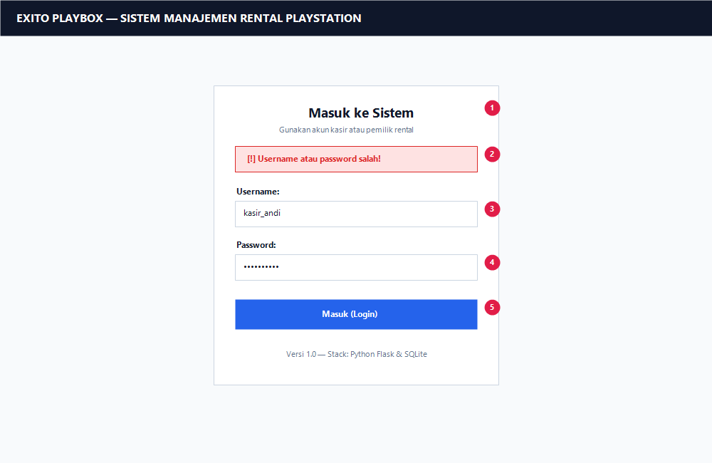
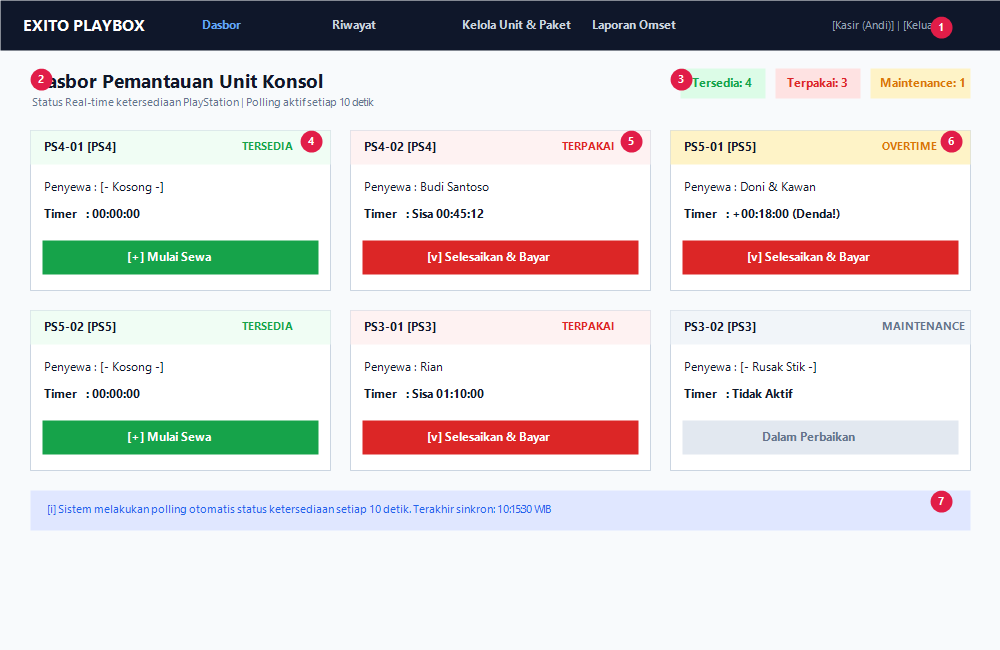
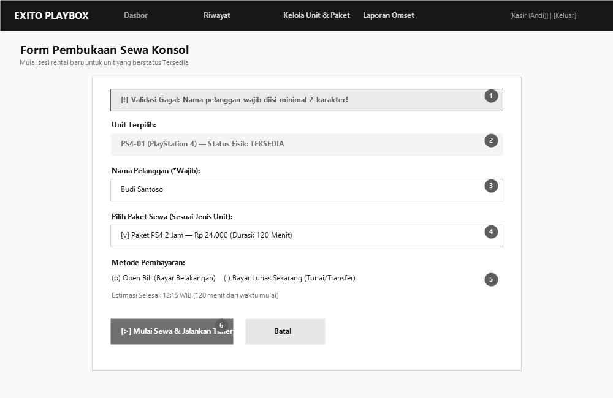
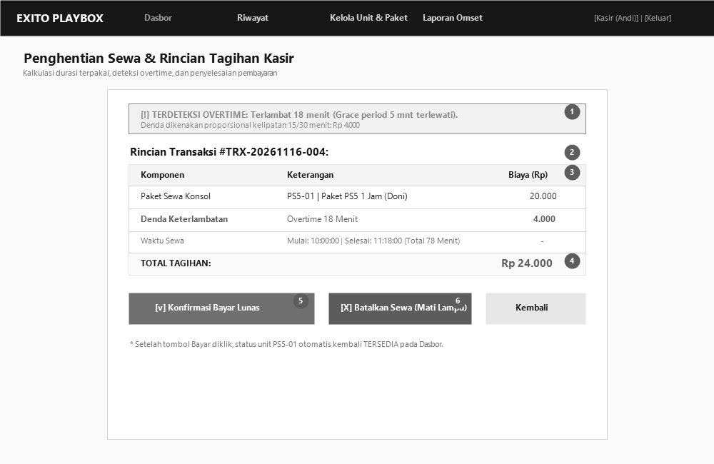
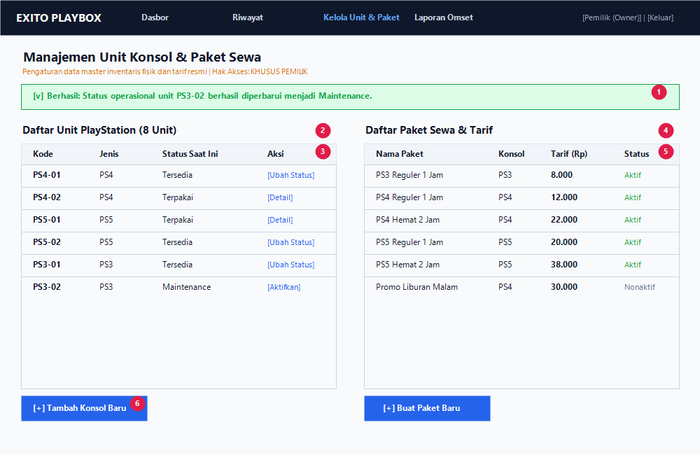

# Manual Pengguna (User Manual) — Exito Playbox v1.0.0

Buku panduan ini disusun untuk membantu **Kasir** dan **Pemilik Rental (Owner)** dalam mengoperasikan Sistem Manajemen Rental PlayStation **Exito Playbox**. Panduan ini menggunakan bahasa sehari-hari yang mudah dipahami, dilengkapi dengan langkah-langkah bernomor dan tabel solusi masalah.

---

## Daftar Isi
1. [Memulai dan Masuk ke Sistem (Login)](#1-memulai-dan-masuk-ke-sistem-login)
2. [Melihat Ketersediaan Unit Konsol (Dasbor Utama)](#2-melihat-ketersediaan-unit-konsol-dasbor-utama)
3. [Mencatat Pelanggan Baru (Buka Sewa)](#3-mencatat-pelanggan-baru-buka-sewa)
4. [Mengakhiri Sesi Sewa & Menghitung Denda (Selesai Sewa)](#4-mengakhiri-sesi-sewa--menghitung-denda-selesai-sewa)
5. [Mencari dan Menyaring Transaksi](#5-mencari-dan-menyaring-transaksi)
6. [Mengelola Master Konsol & Paket Sewa (Khusus Pemilik)](#6-mengelola-master-konsol--paket-sewa-khusus-pemilik)
7. [Tabel Bila Ada Masalah (Panduan Mengatasi Galat)](#7-tabel-bila-ada-masalah-panduan-mengatasi-galat)

---

## 1. Memulai dan Masuk ke Sistem (Login)

### Langkah-langkah:
1. Buka peramban web (Google Chrome), lalu ketik alamat aplikasi: `http://localhost:8000` (atau alamat IP komputer server toko).
2. Anda akan otomatis diarahkan ke halaman **Masuk Sistem**.
3. Ketik **Nama Pengguna** (*username*) dan **Kata Sandi** (*password*) akun Anda.
4. Klik tombol biru **Masuk ke Sistem**.
5. Bila kredensial benar, Anda akan disambut dengan ucapan selamat datang dan menu navigasi sesuai peran Anda (Kasir atau Pemilik).

> [!TIP]
> Demi keamanan, bila Anda salah memasukkan kata sandi sebanyak 5 kali berturut-turut, sistem akan mengunci proses login dari komputer Anda selama 5 menit untuk mencegah tebakan kata sandi liar.

---

## 2. Melihat Ketersediaan Unit Konsol (Dasbor Utama)

Pada menu **Daftar Unit Konsol**, Anda dapat melihat kondisi fisik seluruh PlayStation:
- 🟢 **Badge Hijau (Tersedia):** Konsol kosong dan siap disewa oleh pelanggan baru.
- 🔴 **Badge Merah (Terpakai):** Konsol sedang dimainkan pelanggan. Tidak dapat disewa oleh orang lain.
- 🟡 **Badge Kuning (Maintenance):** Konsol sedang dalam perbaikan stik, kabel, atau pembersihan.

---

## 3. Mencatat Pelanggan Baru (Buka Sewa)

Ketika ada pelanggan yang datang dan ingin bermain:
1. Klik menu navigasi **Buka Sewa** di bilah atas.
2. Masukkan **Nama Pelanggan** (contoh: *"Budi Santoso"*).
3. Pada pilihan **Pilih Unit Konsol**, pilih nomor PlayStation yang diinginkan pelanggan.
   *(Hanya konsol yang berstatus Tersedia yang akan muncul pada daftar pilihan).*
4. Pada pilihan **Pilih Paket Sewa**, pilih paket bermain yang diinginkan (contoh: *"Reguler 1 Jam PS4 — Rp 10.000"*).
5. Pada pilihan **Status Pembayaran**, pilih apakah *"Belum Lunas (Open Bill)"* atau *"Lunas di Awal"*.
6. Klik tombol **Simpan Sewa**.
7. Sistem otomatis mencatat transaksi dan status unit konsol langsung berubah menjadi warna merah (**Terpakai**).

---

## 4. Mengakhiri Sesi Sewa & Menghitung Denda (Selesai Sewa)

Ketika pelanggan selesai bermain:
1. Buka menu **Daftar Sewa**.
2. Cari nama pelanggan atau kode konsol pada tabel transaksi aktif.
3. Klik tombol merah **Selesaikan Sewa** pada baris transaksi pelanggan tersebut.
4. Muncul jendela konfirmasi rincian sesi:
   - Jika pelanggan bermain tepat waktu (atau terlambat dalam masa toleransi 5 menit), denda tercatat **Rp 0**.
   - Jika pelanggan bermain lebih lama (melebihi 5 menit), sistem secara otomatis menghitung denda keterlambatan sebesar **Rp 1.000 per menit kelebihan waktu**.
5. Terima uang denda/biaya dari pelanggan, lalu klik tombol **Konfirmasi Selesai**.
6. Transaksi ditandai **Lunas** dan unit konsol otomatis kembali berwarna hijau (**Tersedia**) untuk pelanggan berikutnya.

---

## 5. Mencari dan Menyaring Transaksi

Untuk mencari nota transaksi lama:
1. Buka menu **Daftar Sewa**.
2. Ketik nama pelanggan pada kotak pencarian **Cari Nama Pelanggan / Konsol**, lalu tekan **Cari**.
3. Anda juga dapat menyaring data menggunakan filter dropdown:
   - Filter Status: *Semua*, *Lunas*, atau *Open Bill*.
   - Filter Jenis: *Semua*, *PS3*, *PS4*, atau *PS5*.
4. Tabel akan menampilkan hasil pencarian yang sesuai secara instan.

---

## 6. Mengelola Master Konsol & Paket Sewa (Khusus Pemilik)

Menu ini hanya dapat dibuka bila Anda masuk menggunakan akun **Pemilik (*Owner*)**:

### Menambah Unit Konsol Baru:
1. Masuk ke menu **Daftar Konsol**, klik tombol **+ Tambah Konsol Baru**.
2. Masukkan Kode Konsol (minimal 4 karakter, misal `PS5-03`).
3. Pilih Jenis Konsol (`PS3`, `PS4`, atau `PS5`).
4. Klik **Simpan**.

### Mengubah Tarif Paket Sewa:
1. Masuk ke menu **Paket Sewa**.
2. Klik tombol **Ubah** pada paket yang ingin diganti tarifnya.
3. Masukkan harga atau durasi baru.
4. Klik **Simpan Pembaruan**.

> [!WARNING]
> Demi keamanan, peran **Kasir** dilarang keras membuka menu Paket Sewa atau mengubah harga. Bila kasir mencoba membuka tautan ini, sistem akan menampilkan halaman penolakan **403 — Akses Ditolak**.

---

## 7. Tabel Bila Ada Masalah (Panduan Mengatasi Galat)

Berikut adalah daftar pesan kesalahan yang mungkin Anda temui dan langkah mudah mengatasinya:

| Pesan Kesalahan pada Layar | Penyebab Masalah | Solusi yang Harus Dilakukan |
|---|---|---|
| **"400 — Permintaan Ditolak (CSRF): Token keamanan formulir tidak valid"** | Halaman formulir telah terbuka terlalu lama sehingga token keamanan peramban kedaluwarsa. | Tekan tombol `F5` pada keyboard untuk memuat ulang formulir, lalu isi dan kirimkan kembali data Anda. |
| **"Terlalu banyak percobaan login gagal. Silakan tunggu 5 menit."** | Terjadi 5 kali salah memasukkan kata sandi secara berulang-ulang dari komputer Anda. | Tunggu selama 5 menit tanpa menekan tombol masuk, atau minta pemilik me-restart server aplikasi. |
| **"403 — Akses Ditolak: Anda tidak memiliki izin untuk membuka halaman ini."** | Akun Kasir mencoba membuka halaman pengaturan master atau rute khusus Pemilik. | Pastikan Anda masuk menggunakan akun Pemilik (*Owner*) bila ingin mengatur tarif dan master konsol. |
| **"Unit konsol sedang dalam sesi sewa aktif dan statusnya tidak dapat diubah secara manual."** | Anda mencoba mengubah status konsol menjadi *maintenance* padahal konsol tersebut masih dimainkan pelanggan. | Buka menu Daftar Sewa, selesaikan sesi sewa pelanggan terlebih dahulu, baru kemudian ubah status unit. |
| **"Nama paket '...' sudah digunakan."** | Anda mendaftarkan nama paket sewa yang sudah pernah ada di sistem. | Gunakan nama paket lain yang belum terdaftar agar tidak membingungkan kasir saat memilih tarif sewa. |
| **"Nama pelanggan wajib diisi / minimal 2 karakter."** | Kolom nama pelanggan pada formulir buka sewa dibiarkan kosong atau hanya berisi 1 huruf. | Ketik nama lengkap pelanggan (minimal 2 huruf) sebelum menekan tombol simpan sewa. |
| **"Tidak dapat terhubung ke server (Connection Refused)"** | Proses server Waitress belum dinyalakan di komputer server toko. | Jalankan kembali perintah server: `waitress-serve --listen=0.0.0.0:8000 app:app` di terminal komputer server. |
