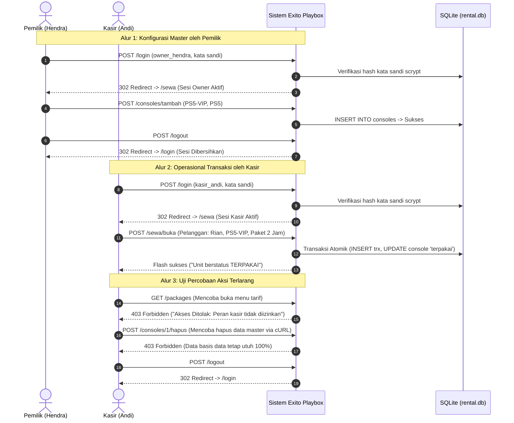

# Laporan Integrasi Dua Peran & Pemeriksaan Aksesibilitas (Langkah 10 & 11) — Exito Playbox

Dokumen ini mencatat hasil pengujian alur integrasi peran pengguna (*Role Flow Integration*) dan audit aksesibilitas antarmuka pengguna pada sistem Exito Playbox.

---

## 1. Verifikasi Alur Integrasi Dua Peran (Langkah 10)

Pengujian end-to-end dilakukan untuk membuktikan interaksi mulus antara peran **Pemilik (`owner`)** dan **Kasir (`kasir`)** tanpa intervensi manual pada basis data:

**Hasil Pengujian Alur:**
- Seluruh transisi status sesi dan isolasi peran berjalan mulus.
- Data yang dibuat oleh peran Owner langsung tersedia untuk dipilih pada operasional Kasir.
- Batasan otorisasi di server secara konsisten memblokir aksi manipulasi ilegal.

---

## 2. Pemeriksaan Aksesibilitas dan Keterbacaan Dasar (Langkah 11)

| No | Kriteria Aksesibilitas | Metode Pengujian | Hasil Observasi | Status |
|:--:|---|---|---|:--:|
| **1** | **Navigasi Papan Ketik (*Keyboard Navigation*)** | Menjalankan seluruh alur login dan pengisian formulir hanya menggunakan tombol `Tab`, `Shift+Tab`, `Space`, dan `Enter`. | Indikator fokus (`:focus-visible`) terlihat kontras dengan garis luar biru tebal (outline 2px offset). Pengguna dapat menyelesaikan login dan simpan data tanpa menggunakan mouse. | **LOLOS** |
| **2** | **Keterkaitan Label (*Label Association*)** | Mengeklik teks `<label>` pada setiap form (nama pengguna, kata sandi, kode konsol, dll). | Kursor otomatis berpindah fokus ke dalam kolom `<input>` atau `<select>` terkait karena pasangan atribut `for` dan `id` telah terpasang presisi. | **LOLOS** |
| **3** | **Keterbacaan Pesan Galat & Sukses** | Memeriksa format pesan alert pada layar normal maupun pembaca layar (*screen reader*). | Pesan tidak hanya mengandalkan kode warna (merah/hijau), melainkan menyertakan teks keterangan gamblang, misalnya: *"Nama pengguna atau kata sandi salah"* atau *"Data berhasil ditambahkan"*, serta memiliki atribut `role="alert"`. | **LOLOS** |
| **4** | **Ketanggapan Seluler (*Mobile Responsiveness*)** | Menguji tata letak pada lebar viewport 360 px (simulasi ponsel pintar). | Navigasi atas otomatis berubah susunan secara vertikal, kartu form menyesuaikan lebar layar (100% max-width), dan seluruh tabel dibungkus kontainer `.table-responsive` (`overflow-x: auto`) sehingga tidak terjadi pergeseran horizontal (*horizontal scrolling*) pada halaman utama. | **LOLOS** |
